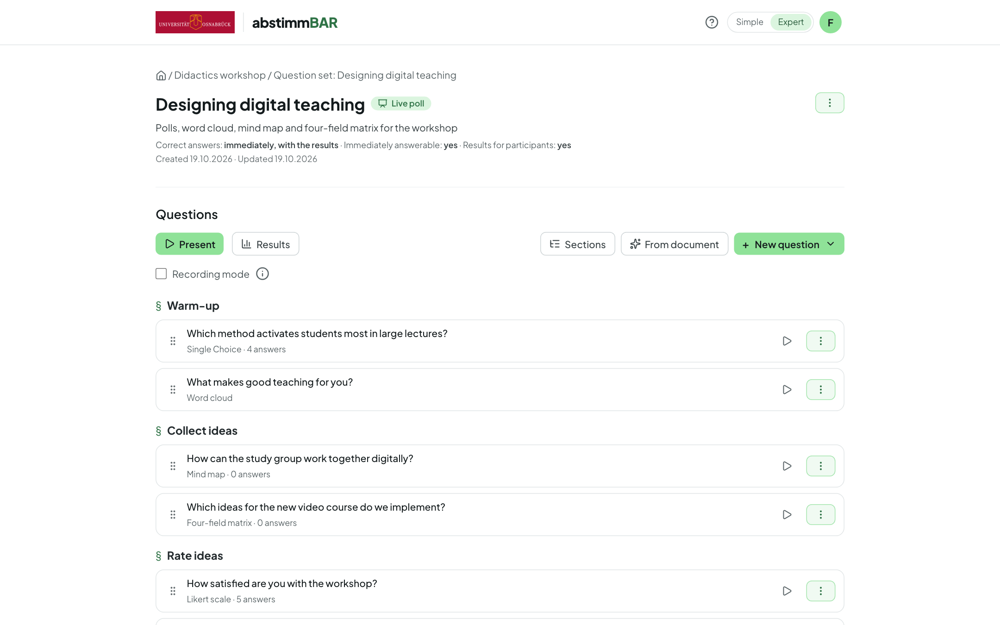
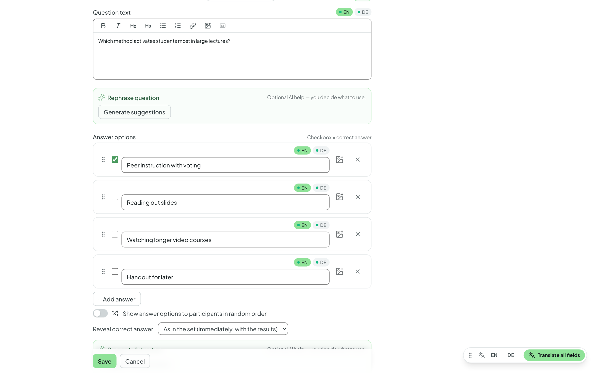
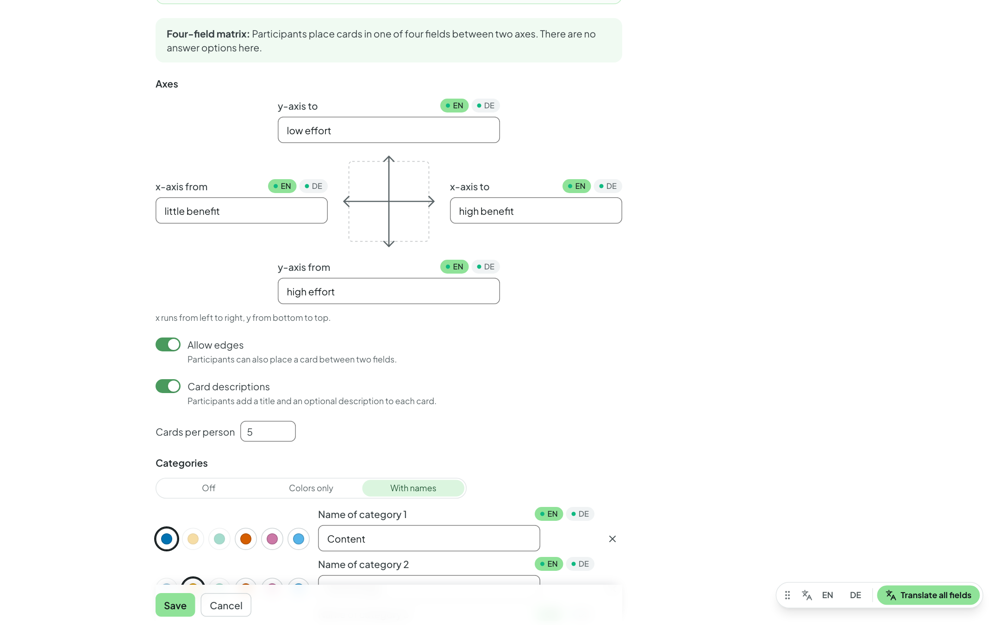

# Creating questions

Within a [room](rooms.md) you create one or more **question sets** — for
example one per session. A question set is what you later present or
publish.

## Question set type and settings

When creating a set, you choose its **type** — **Live poll**,
**Self-paced quiz** or **Self-check**. It determines how the set is run and
which question types are available; details and examples of use are given
in [Types of question sets](set-types.md).

Via the set's **⋮** menu → **Settings** you change the title, description
and (in expert mode) the set's behaviour under **Answers & results** — which
options are available depends on the type. Below the set's title, a line
sums up the most important settings.

## Sections (expert mode) { #sections-expert-mode }



Structure longer sessions into **sections**. In the set, click
**Sections**: **“+ Section here”** inserts a heading, clicking its name
renames it, and the handle lets you move it; drag questions below the
matching heading. You can optionally give each section a **description**.
In the presentation, an **interstitial slide** with the title and
description appears before the section (only on the projector, not for
participants); press ++s++ or ++arrow-right++ to bring up the section's
first question.

## Adding a question

Add a new question to the set via **“+ New question”**. The menu groups the
question types by **what your participants do** — so every type has exactly
one place. It only shows the types the set's type allows.

### Choose

Participants choose from given answers.

- **Single Choice** — exactly one answer can be selected; a correct answer
  can be marked.
- **Multiple Choice** — several answers can be selected at once.
- **Yes/No** — two answers; pick the **Yes/No** or **True/False** template,
  or enter your own.



### Rate & order

Participants rate, weight or order.

- **Likert scale** — agreement on a fixed, ordered scale (e.g. from
  “applies” to “does not apply”), optionally with an abstain option.
- **Priorities** — your participants distribute up to **100 points** across
  the answers: the more important, the more points. The evaluation shows the
  average for each answer (with minimum and maximum), sorted in descending
  order — so you can see what matters most to the group. There is no
  “correct” answer.
- **Ordering** — your participants drag and drop items into the right
  order. The order in which you save the items in the editor is the
  solution; participants see them shuffled. The evaluation shows how many
  got the order **completely right** and, for each pair of consecutive
  items, how often they were placed **directly in sequence** — so you can
  spot which transitions cause difficulties.

### Answer openly

Participants answer in their own words — also for collecting ideas
together.

- **Free text** — open answers (up to 500 characters), shown as a list.
  Optionally with a **model solution** and AI evaluation (see
  [AI assistance](ai-assistance.md)).
- **Word cloud** — short terms that grow into a cloud live (identical words
  are merged, even with different upper and lower case). You can set the
  **maximum contributions per person**, whether several terms are
  **collected and submitted together** (up to five fields at once), and
  whether the cloud **already grows on the projector while voting is open**
  or only appears after closing.
- **Mind map** — participants build a tree of terms together; identical
  terms are merged with a count. You can set the **depth**, the number of
  **terms per person**, title + description, and **predefined branches**.
  Optionally, a **rating phase** follows (points or plus/minus, see
  [Presenting](presenting.md#mind-map)). Only available in live polls.
- **Four-field matrix** — participants place cards on a grid with two axes,
  e.g. “low/high effort” versus “low/high benefit”. Only available in live
  polls; details below.

### Setting up the four-field matrix



You label both ends of both axes (bilingual if you like); the fields are
called top right, top left, bottom left and bottom right. You can set:

- **Allow edges** — cards may also sit on the axis lines, i.e. between two
  fields.
- **Card descriptions** — in addition to the title.
- **Cards per person**.
- **Categories**: *Off*, *Colors only* (up to six colors you pick freely
  from the palette; on smartphone and projector they are named by letters
  A–F in order) or *With names* (color plus name, e.g. “On campus” and
  “Digital”). At least two categories are required.
- an optional **rating phase** — points or plus/minus with a budget per
  person, optionally several points per card and display of the interim
  standings during rating.
- **Enable AI features** — for
  [AI grouping](presenting.md#ai-summarize-expert-mode) on the projector.

On their smartphones, participants choose a field (the “+” areas), enter a
title (and, where applicable, a description and category) and see under
“Your cards” how many more they may place; they can delete their own cards
there.

## Solution and other settings per question

For choice questions, you mark the correct answer(s). Whether and when the
solution is shown is set per set and can be overridden per question:
**immediately**, **after closing** the question, or **never**.

- **Random order** — shuffles the answers anew for each presentation; all
  participants see the same order.
- **Time limit** — closes voting automatically after the chosen time.
- **Images** — insert images into the question text via the image icon in
  the toolbar (or by dragging them in); each answer can have its own image,
  too. You can add an [image credit](#bildnachweise) to every image.

## Image credits { #bildnachweise }

Every image — in the question text, as an answer image or imported — can carry
an image credit. It is **never mandatory**; missing details block nothing.

As soon as the saved question contains images, the editor shows an **Image
credits** section below the question text. Each image gets a card with a
thumbnail and these fields:

- **Author** and **Title** of the image,
- **Source** — a link (`http://` or `https://`),
- **License** — CC BY, CC BY-SA, CC BY-ND, CC BY-NC, CC BY-NC-SA, CC BY-NC-ND,
  CC0, Public domain, All rights reserved, Other or Unknown. For CC licenses
  you also pick the **version**; for **Other** you add a **license note**
  (optional for **All rights reserved**).

**Save credit** stores the details; images without a credit are marked **No
image credit**. Newly inserted images appear in the section once you have
saved the question.

The credit belongs to the image, not to a single question: it may be changed
by the person who uploaded the image and by anyone who owns all the rooms in
which the image is used. If the image is also used in someone else's room, you
only see the credit. The change applies everywhere the image is used (e.g. in
duplicated sets). Copies, duplicates and the JSON export keep
the credits (older Abstimmbar versions ignore them on import).

The credit is shown as a compact line below the question — on the beamer
(also in the results walkthrough, there without links) and on the participant
page (with the title and license linked), e.g. *Image: "Freshly Picked
Blackcurrants" by Karen Jackson, CC BY-ND 4.0*; with several images *Images:
… · …*. In the wide mindmap and four-field matrix view, where images are
hidden, no line appears. Only images visible in the displayed language get a
credit.

## Bilingual content (expert mode)

You can store questions, answers, titles and descriptions in **German and
English** (language tabs **DE · EN** on the field). How this works and what
participants then see is described in
[Bilingual content](bilingual-content.md).

## Before/after questions (expert mode) { #before-after-questions-expert-mode }

With a before/after question, you ask **the same question twice** — for
instance at the start and again after your explanation or a discussion —
and show both results side by side. This makes learning progress or changes
of opinion visible.

This works for **Single Choice** (including Yes/No), **Multiple Choice** and
**Likert scale**.

**How to create one:**

1. Create the question as usual — it becomes the **before-question**.
2. In the question list, open this question's row menu **⋮** and choose
   **“Add after-question”**.
3. Abstimmbar creates a copy at the **end of the set**. Drag it to the place
   where you want to ask the question again — e.g. after the section with
   your input.

In the list, the two questions are labelled **Before** and **After**. You
only edit the content in the before-question; the after-question picks up
every change automatically (it shows a read-only preview with the link
**“Open before-question”**). If you delete the before-question, the
after-question is deleted along with it. Each question can have only one
after-question.

**In the presentation**, you ask both questions like any other. When you
show the results of the after-question, the before-result appears as a
lighter bar above the after-result for each answer; for a Likert scale,
the before-distribution appears muted above the new one. **On the results
page**, both results are likewise shown side by side, labelled **Before**
and **After**. The votes are counted separately.

## Importing existing questions { #fertige-fragen-ubernehmen }

If your questions already exist — from earlier semesters, from Moodle or
ILIAS, or from a tool of your own — you don't have to retype them.
**Import questions** reads them **verbatim**: with question type, answers
and marked correct answers. Nothing is reworded or shortened. It needs no AI
and is available in both simple and expert mode. To bring in questions from
your own sets, use **Add questions from another set** instead (see
[Reusing questions](#reusing-questions)).

How it works:

1. Open the question set and choose **Import questions**.
2. Paste the text or upload a file (`.txt`, `.gift`, `.h5p`, `.zip` or
   `.xml`). The format is detected automatically.
3. The **Review imported questions** view shows the detected format, the
   questions and a list of what could not be imported. Select the questions
   you want to keep and accept them. Only then are they created in the set.
   The others are kept for later review until you discard the rest.

Images from **H5P** (above the question, inline and as answer images) are
imported together with their [image credit](#bildnachweise) — author, title,
source and license come from the H5P metadata. Images from **ILIAS** (question
and answer images) are imported without a credit, since ILIAS provides none.
At most 100 images are taken over per import. **GIFT** and the simple text
format cannot carry images; there the notice "Image not imported" remains.
Feedback texts are not imported. AI evaluation for free-text questions is off for
imported questions; switch it on in the question's editor if you want it.
Nothing disappears silently: anything skipped is reported with a count and
the reason.

### The simple text format

```text
Q: Which city is the capital of Lower Saxony?
* Hanover
- Osnabrück
- Brunswick

Q: Which numbers are even? [multiple]
* 2
- 3
* 4

Q: The Earth is flat.
- True
* False

Q: Put the steps in the correct order.
1. Plan
2. Implement
3. Review

Q: What are you taking away from today's session?
A: A possible model solution (optional)
```

[Download the example file](example-questions.txt){ download }

- A new question starts with `Q:` (or `F:`). Further lines without a prefix
  belong to the question text until the first option.
- `*` marks a correct option, `-` a wrong one; the marker is followed by a
  space (so `-5 degrees` stays question text). Exactly one correct option
  gives a single choice, several correct options a multiple choice, none a
  survey question. `[multiple]` at the end of the question line forces a
  multiple choice.
- Exactly the two options True/False (or Wahr/Falsch) give a true/false
  question.
- Numbered lines (`1.`, `2.` …, also followed by a space) give an ordering
  question in that order.
- Without options the question is free text; `A:` (or `L:`) sets a model
  solution.
- Blank lines separate questions but are not required. Lines starting with
  `#` or `//` are comments.
- A question with only one option, mixed markers or empty text is skipped and
  reported with its line number.
- At most 200 questions are read per import; pasted text and text files may
  be at most 1 MB.

### Other formats

| Format | Imported | Skipped (with notice) |
|---|---|---|
| **GIFT** (Moodle text format, `.gift`/`.txt` or pasted) | Multiple choice, weighted answers with several positive weights (multiple choice), true/false, short answer (free text with model solution), essay (free text) | Matching, numerical questions, cloze, descriptions (text without an answer block) |
| **H5P** (`.h5p`) | Multiple Choice, True/False, Single Choice Set, Essay; also inside Question Set and Column; images with credits | all other H5P content types (e.g. Blanks), counted by name |
| **ILIAS** (export of a test or question pool as `.zip`, or the `.xml` alone) | Single choice, multiple choice, free text, ordering with text; images in question and answers (without credit) | all other question types (e.g. Kprim, cloze, matching), ordering with images |

For GIFT, titles (`::Title::`), categories, comments and feedback are
ignored. For ILIAS, the current QTI export is read; older type names are
recognised as well.

## Reusing questions { #reusing-questions }

- **Add questions from another set** (the set's ⋮ menu) — pick questions
  from your other sets and copy them here. Question types the set's type
  doesn't allow are marked.
- **Copy to another set** or **Move to another set** — via a question's row
  menu.
- **Duplicate** (expert mode) — copies the whole set, also into another of
  your rooms; that way you can reuse it next semester, for example.
- **Export (JSON)** (expert mode) — saves the set as a file. In a room, you
  bring such a file back in via the ⋮ menu → **Import question set (JSON)**,
  for example on another Abstimmbar instance. Uploaded images are included
  in the file and come along on import, as do their image credits; an import file may be up to 32 MiB.
- **Copy set (share link)** (expert mode) — creates a link that colleagues
  can use to take a copy of the set **into their own room**; your original
  remains unchanged. Optionally, you specify a **license for sharing**
  (e.g. CC BY 4.0). If you want to work on the same set together, share the
  room instead (see [Rooms as a team](team.md)).
